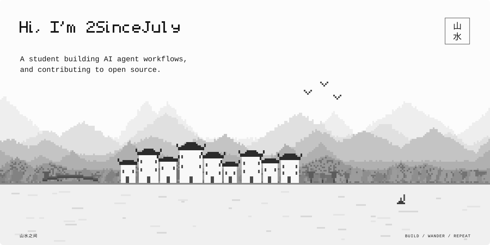

---

### Focus

A university student learning to program.

- Interested in AI development, especially agent workflows and tooling.
- Working on improving my programming skills, contributing to open source, and learning new technologies.

Welcome to my GitHub profile.

### Contributing to

<!-- CONTRIBUTIONS:START -->
- **[REA](https://github.com/morluto/rea)**  - join IPS images to admitted Mach-O slices; expose provider selection diagnostics in session status; report V8 cachedData compilation boundaries.
- **[DeerFlow](https://github.com/bytedance/deer-flow)**  - drop empty typed text blocks from user content; evict in-memory runs when a thread is deleted.
- **[Nature Skills](https://github.com/Yuan1z0825/nature-skills)**  - accept ggsave(device = cairo_pdf) in editable-text check.
- **[Qwen Code](https://github.com/QwenLM/qwen-code)**  - name the active shell in the startup context; only file issues on failure and reconcile stale ones; drive the reconcile probe through the Broker's real rejection path.
- **[AI-Infra-Guard](https://github.com/Tencent/AI-Infra-Guard)**  - add 15 AI product CVE advisories from NVD.
- **[OpenJudge](https://github.com/agentscope-ai/OpenJudge)**  - reject non-finite numbers in JsonValidatorGrader; stop JsonMatchGrader matching a missing key against null; align LLMGrader.from_config with BaseGrader.from_config.
<!-- CONTRIBUTIONS:END -->

### Stack

  
  
  
  
  
  
  

